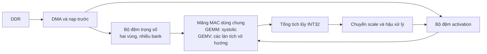

# Các file nguồn của SmolLM2-135M

`source.lock.json` ghi lại phiên bản model và mã kiểm tra (SHA-256) của từng file để biết bộ nguồn đang dùng có đúng phiên bản đã chọn hay không.

| File                        | Công dụng                                                                      |
| --------------------------- | -------------------------------------------------------------------------------- |
| `config.json`             | Chứa cấu hình và kích thước các thành phần của model.                 |
| `generation_config.json`  | Chứa thiết lập mặc định khi model sinh token.                              |
| `model.safetensors`       | Chứa các trọng số đã huấn luyện mà model dùng để tính toán.        |
| `merges.txt`              | Chứa quy tắc ghép các mảnh chữ khi tách văn bản thành token.           |
| `vocab.json`              | Ánh xạ các token với mã số tương ứng.                                   |
| `tokenizer.json`          | Chứa dữ liệu tokenizer để chuyển văn bản thành token và ngược lại.  |
| `tokenizer_config.json`   | Chứa thiết lập tokenizer, như cách xử lý văn bản và token đặc biệt. |
| `special_tokens_map.json` | Ghi tên và cách nhận diện các token đặc biệt, như token kết thúc.    |

# Các Ghi chú quan trọng

## Smoothing và requantization trong numerical contract

Phần này giải thích các công thức ở [§4.2 — Hệ số nhân–dịch và requantization](../design/numerical_contract_v1.md#numerical-contract-v1-4-2).

### Hệ số tham chiếu trước quantize A

SmoothQuant biến đổi activation và trọng số theo `x'[i] = x[i] / s[i]`, `W'[o,i] = W[o,i] * s[i]`. Trước lượng tử hóa, hai hệ số `s[i]` triệt tiêu trong từng tích nên kết quả Linear được bảo toàn.

Gọi `q_in[i]` là mã số nguyên đầu vào, `delta_in` là scale và `z_in` là zero-point. Giá trị thực mà mã đầu vào biểu diễn là `x[i]`. Sau smoothing, giá trị này được lượng tử hóa thành A với scale đích `delta_A`:

```text
Giá trị thực được biểu diễn:  x[i]  = delta_in * (q_in[i] - z_in)
Sau smoothing:               x'[i] = x[i] / s[i]
Đổi sang đơn vị mã A:        u[i]  = x'[i] / delta_A
```

Thay hai dòng đầu vào dòng cuối:

```text
u[i] = (q_in[i] - z_in) * delta_in / (s[i] * delta_A)
     = (q_in[i] - z_in) * c[i]

c[i] = delta_in / (s[i] * delta_A)
```

Do đó, `c[i]` là hệ số nhân lý tưởng để đưa mã đầu vào sang đơn vị mã A sau smoothing, trước rounding và clipping:

```text
qA[i] = clip(RNE(c[i] * (q_in[i] - z_in)), -2048, 2047)
```

Trong công thức này, `delta_in` chuyển mã đầu vào thành giá trị thực; chia `s[i]` thực hiện smoothing; chia `delta_A` chuyển giá trị sau smoothing sang đơn vị mã A12. `RNE` là làm tròn về số nguyên gần nhất, trường hợp chính giữa chọn số chẵn. Nếu scale đầu vào thay đổi theo feature thì dùng `delta_in[i]` thay cho `delta_in` trong hệ số tương ứng.

Ví dụ với `q_in=100`, `z_in=0`, `delta_in=0.02`, `s=4`, `delta_A=0.01`:

```text
x  = 100 * 0.02 = 2
x' = 2 / 4 = 0.5
qA = RNE(0.5 / 0.01) = 50

c  = 0.02 / (4 * 0.01) = 0.5
qA = RNE(100 * 0.5) = 50
```

Gọi là **hệ số tham chiếu** vì `c[i]` là tỷ lệ toán học cần thực hiện. Trong datapath số nguyên, hệ số được biểu diễn bằng multiplier–shift, chẳng hạn `c[i] ≈ M[i] / 2^r[i]`. Độ rộng `M`, miền dịch, độ rộng tích và vị trí rounding được quy định trong [§4.2 của numerical contract v1](../design/numerical_contract_v1.md#numerical-contract-v1-4-2); công thức tham chiếu không tự quyết định các thông số đó.

### Requantization và chuyển scale

**Requantization là chuyển một giá trị đã có biểu diễn số nguyên sang một biểu diễn số nguyên khác**, thường có scale hoặc số bit khác. Với zero-point bằng 0 ở cả đầu vào và đầu ra:

```text
q_out = clip(RNE(q_in * delta_in / delta_out), qmin_out, qmax_out)
```

Mục tiêu là giữ gần đúng giá trị thực đã biểu diễn:

```text
delta_out * q_out ≈ delta_in * q_in
```

Vì vậy, requantization không chỉ là ép kiểu hoặc cắt bit; hệ số chuyển đổi phải xét tỷ lệ giữa hai scale. Sai khác có thể phát sinh từ rounding, clipping và việc xấp xỉ hệ số bằng multiplier–shift.

Riêng accumulator Linear có scale `delta_A * delta_W[o]` và zero-point 0, nên hệ số chuyển sang scale output là:

```text
c_out[o] = delta_A * delta_W[o] / delta_out[o]
q_out[o] = clip(RNE(acc[o] * c_out[o]), qmin_out, qmax_out)
```

Smoothing rồi quantize A có thêm phép chia `s[i]` so với chuyển scale thông thường, vì vậy hệ số `c[i]` có thêm `s[i]` ở mẫu số. Gộp các hệ số này giúp hiện thực đường chuyển đổi bằng nhân và dịch số nguyên, thay vì phải tái dựng giá trị thực tại runtime.  
  
  
**Với mục tiêu thiết kế một matmul engine dùng tốt cho cả prefill và decode, tôi nghiêng về lấy cơ chế chuyển GEMM/GEMV của SPECTRA làm tham khảo chính, kết hợp cách giữ activation trên chip và tổ chức truyền trọng số của FlightLLM.** Riêng chuỗi DSP hỗ trợ sparsity của FlightLLM chỉ đáng đưa vào khi model của anh thực sự được cắt tỉa trọng số và đã kiểm tra chất lượng.

Tôi đã đọc hai bản [SPECTRA.pdf](/home/hoang_hung/RISCV-TinyLLM-Dilithium/src/tinyllm/docs/papers/SPECTRA.pdf) và [FlightLLM.pdf](/home/hoang_hung/RISCV-TinyLLM-Dilithium/src/tinyllm/docs/papers/FlightLLM.pdf). Các số trang bên dưới theo những bản này. Phần giải thích tập trung vào những gì cần để chọn kiến trúc và chuyển sang RTL; các đề xuất cho TinyLLM là nhận định của tôi, chưa phải kết quả tổng hợp mạch.

Trước hết, có thể phân biệt hai bài như sau:

| Nội dung | SPECTRA | FlightLLM |
|---|---|---|
| Vấn đề chính | Một phần cứng phải chạy hiệu quả các phép toán có hình dạng rất khác nhau | Làm cho việc nén model thực sự giảm thời gian chạy trên FPGA |
| Cách giải quyết ở engine | Cùng mảng PE, đổi giữa systolic và các làn tính tích vô hướng | Ghép nhiều đơn vị tích vô hướng bằng chuỗi DSP có thể cấu hình |
| Điểm mạnh đáng tham khảo | Chuyển cách dùng tài nguyên giữa GEMM và GEMV | Tận dụng DSP, giữ activation trên chip, truyền trọng số nén |
| Phần hệ thống | Nhiều tile, chia phép toán và chuyển dữ liệu linh hoạt | Nhiều core, phân bố dữ liệu qua HBM, bộ lệnh và trình biên dịch |
| Chi phí cần chú ý | Mux, điều khiển, chia bank và mạng liên kết | Điều khiển sparsity, giải nén, bộ đệm và phần mềm ánh xạ |

**Điểm xuất phát chung là: GEMM và GEMV khác nhau chủ yếu ở khả năng dùng lại trọng số.**

Xét phép tính:

\[
C_{M\times N}=A_{M\times K}B_{K\times N}
\]

Trong các lớp Linear của LLM:

- \(M\): số token được xử lý cùng lượt.
- \(K\): số phần tử đầu vào của mỗi token.
- \(N\): số phần tử đầu ra.

Trong prefill, nhiều token dùng chung một ma trận trọng số. Một trọng số được đọc vào có thể dùng cho nhiều phép nhân. Trong decode với một chuỗi đang sinh, chỉ có một token mới, nên mỗi trọng số thường chỉ đóng góp một phép nhân trong lượt đó.

| Trường hợp | Giá trị \(M\) điển hình | Điều phần cứng cần làm tốt |
|---|---:|---|
| Prefill dài | Vài chục đến hàng trăm token hoặc hơn | Dùng lại trọng số và giữ nhiều phép MAC hoạt động |
| Decode một chuỗi | 1 | Đọc trọng số liên tục, tránh để nhiều PE trống |
| Prefill ngắn hoặc kiểm tra token suy đoán | Một số ít token | Cân bằng giữa dùng lại dữ liệu và chi phí điều phối |

Nếu chỉ tính lưu lượng trọng số, giả sử mỗi trọng số được đọc một lần, cường độ tính toán xấp xỉ:

\[
AI \approx \frac{2M}{b_W}\quad\text{phép toán/byte}
\]

với \(b_W\) là số byte của một trọng số, và một MAC được tính là hai phép toán.

SPECTRA minh họa bằng trọng số 32 bit nên nhận được \(AI=M/2\). Với W8, cùng giả định đó sẽ là \(AI\approx2M\). Đây là lý do không nên mang trực tiếp con số FLOP/byte của bài sang cấu hình W8A12.

Prefill dài thường bị giới hạn bởi khả năng tính toán, decode thường bị giới hạn bởi băng thông. Tuy nhiên, điều này còn phụ thuộc kích thước engine, bộ nhớ và cách chia tile; không phải mọi GEMM đều tự động thuộc miền giới hạn tính toán.

---

**SPECTRA giải quyết việc chuyển giữa hai kiểu công việc bằng cách thay đổi luồng dữ liệu trong cùng một mảng PE.**

Bối cảnh của bài là *speculative decoding*: model nhỏ sinh thử một đoạn token, rồi model lớn kiểm tra đoạn đó trong một lượt. Ví dụ, nếu độ dài suy đoán là \(\gamma=8\):

- Model nhỏ chạy nhiều lượt decode với \(M=1\).
- Model lớn kiểm tra một nhóm token với \(M=\gamma+1=9\).
- Prefill ban đầu vẫn xử lý nhiều token.

Như vậy, phần cứng phải chạy cả GEMV, GEMM nhỏ và GEMM lớn. Ý tưởng kiến trúc này vẫn hữu ích cho anh dù chưa triển khai speculative decoding.

SPECTRA cho phép thay đổi ở hai mức: **cách hoạt động bên trong một tile** và **cách nhiều tile phối hợp**. Việc cấu hình diễn ra theo từng phép toán, bằng thanh ghi và điều khiển; không cần nạp lại bitstream.

Một tile gồm:

- Mảng PE tính nhân–cộng.
- Bộ nhớ riêng cho activation, trọng số, tổng tích lũy và đầu ra.
- Khối hậu xử lý cho attention, normalization và hàm phi tuyến.
- Các bộ điều khiển nạp, tính, hậu xử lý và ghi kết quả.
- Khối giao tiếp với bộ nhớ ngoài và các tile khác.

Các bộ nhớ dùng hai vùng đệm luân phiên: trong khi vùng này đang được tính, vùng còn lại có thể nhận dữ liệu tiếp theo. Những bộ điều khiển cũng hoạt động đồng thời khi quan hệ phụ thuộc dữ liệu cho phép. Mục tiêu là tránh chuỗi tuần tự “nạp xong tất cả → tính xong tất cả → ghi”.

Phần trực tiếp liên quan đến matmul nằm ở **Hình 3, trang 4**.

Mảng tính có kích thước **8×8, gồm 64 PE**, mỗi PE có một MAC. Bộ nhớ trọng số có **64 bank**; bộ nhớ activation, tổng tích lũy và đầu ra có **8 bank**.

Ở chế độ GEMM, mảng hoạt động theo kiểu **output-stationary systolic**:

- Activation truyền theo một hướng, trọng số theo hướng còn lại.
- Dữ liệu vào được làm lệch thời gian giữa các hàng để gặp đúng toán hạng.
- Mỗi PE giữ và cập nhật một tổng tích lũy đầu ra.
- Khi hoàn thành chiều \(K\), kết quả được lấy ra.

Hiểu đơn giản, mỗi PE chịu trách nhiệm cho một phần tử của khối đầu ra. Dữ liệu đi qua mảng và được nhiều PE sử dụng, giúp giảm số lần đọc bộ nhớ.

Đổi lại, phải xử lý thời gian lấp đầy/rút dữ liệu khỏi pipeline và các khối không vừa kích thước mảng. Nếu ánh xạ một token lên mảng theo cách chỉ dùng một hàng, phần lớn PE sẽ không làm việc.

Ở chế độ GEMV, **cùng 64 PE đó được tổ chức thành 8 làn tích vô hướng**. Engine thay đổi cách cấp activation, đọc trọng số và cộng kết quả. Bộ nhớ trọng số được đánh địa chỉ để có thể cấp cả khối **8×8 trọng số trong một chu kỳ**.

Một cách diễn đạt tương đương về phép toán là:

\[
y[n:n+7]\mathrel{+}=
x[k:k+7]\;W[n:n+7,k:k+7]^T
\]

Tức là dùng 64 phép nhân để cập nhật tám đầu ra từ tám phần tử đầu vào. Đây là cách diễn giải việc phân bố phép tính, không phải lịch tín hiệu chính xác từng chu kỳ của bài.

**Điểm cần học là chuyển phần cứng vốn phân bố theo các hàng token sang cùng xử lý chiều tích vô hướng và các đầu ra của một token.** Chỉ đổi bộ đếm \(M\) thành 1 sẽ không đạt được điều đó.

Việc chuyển chế độ vì vậy ảnh hưởng đến:

- Nguồn toán hạng đi vào từng PE.
- Địa chỉ và cách đọc các bank.
- Đường truyền tổng tích lũy.
- Vị trí giữ kết quả và thời điểm lấy kết quả ra.

Đây cũng là lý do cấu trúc bộ nhớ quan trọng ngang với cấu trúc MAC. Có 64 MAC nhưng bộ nhớ chỉ cấp được tám trọng số mới mỗi chu kỳ thì chế độ GEMV vẫn không thể dùng hết mảng.

Cần phân biệt **băng thông bên trong chip** với **băng thông DDR**. Bộ nhớ cục bộ cấp đủ 64 trọng số/chu kỳ chỉ bảo đảm engine có thể tính ở tốc độ đó khi dữ liệu sẵn sàng. DDR phải nạp kịp vùng đệm tiếp theo mới duy trì được hoạt động lâu dài.

SPECTRA còn ghép xử lý attention vào tile, thể hiện ở **Hình 4, trang 4**. Thay vì tạo và lưu toàn bộ ma trận điểm attention, hệ thống xử lý lần lượt các khối K/V:

1. Tính điểm attention cho một khối.
2. Cập nhật giá trị lớn nhất và tổng chuẩn hóa của hàng.
3. Kết hợp đóng góp của khối V vào đầu ra.
4. Tiếp tục với khối K/V kế tiếp.

Đó là cách tổ chức theo FlashAttention, dùng softmax trực tuyến. Lợi ích chính là giảm bộ nhớ trung gian và việc đọc/ghi ma trận điểm attention. V buffer cũng dùng hai vùng đệm để nạp và tính chồng lấp.

Với nhiều query, phần tích lũy đầu ra nằm trong bộ nhớ nhiều bank. Với decode hoặc số query nhỏ, có thể dùng cấu trúc thanh ghi gọn hơn. Bài học là **cùng một phép toán nhưng cách giữ trạng thái nên phù hợp với kích thước công việc**.

Ở mức nhiều tile, SPECTRA hỗ trợ ba cách chia phép nhân ma trận:

| Cách chia | Mỗi tile làm gì? | Dữ liệu phải chia sẻ | Chi phí đáng chú ý |
|---|---|---|---|
| Theo \(N\) | Tính các nhóm đầu ra khác nhau | Activation dùng chung | Không cần cộng kết quả giữa các tile |
| Theo \(K\) | Tính một phần của mỗi tích vô hướng | Phải ghép các tổng từng phần | Cần đường cộng kết quả và đồng bộ |
| Theo \(M\) | Tính các nhóm token khác nhau | Trọng số dùng chung | Có thể phải đọc hoặc nhân bản trọng số |

Để hỗ trợ các cách chia này, hệ thống có DMA, truyền trực tiếp giữa tile và multicast — gửi cùng dữ liệu tới nhiều tile.

Các nhóm tile còn có thể chạy hai toán tử liên tiếp rồi truyền activation trực tiếp cho nhau, giảm lượt ghi ra và đọc lại từ DDR. Phần mềm chọn số tile, chiều chia và kiểu giao tiếp theo một mô hình chi phí được hiệu chỉnh bằng kết quả trên FPGA; CPU thực thi cấu hình đã chọn.

Điều cần tránh khi tham khảo là coi cách chia tốt nhất trong bài thành quy tắc cố định. Trong thử nghiệm SPECTRA, chia theo \(K\) là phương án cố định mạnh, nhưng với engine của anh, chia theo \(N\) có thể là điểm bắt đầu đơn giản hơn vì không cần cộng kết quả giữa các khối.

Chi phí chuyển chế độ được thể hiện trong **Bảng 2, trang 7**:

| Cấu hình datapath | LUT | FF | BRAM | URAM | DSP |
|---|---:|---:|---:|---:|---:|
| Chỉ vector | 52.149 | 69.791 | 68 | 12 | 276 |
| Chỉ systolic | 48.426 | 57.863 | 104 | 18 | 279 |
| Chuyển được hai chế độ | 88.206 | 103.564 | 112 | 18 | 308 |

So với bản chỉ systolic, bản hai chế độ tăng khoảng:

- **82% LUT và 79% FF**.
- **10,4% DSP**.
- **7,7% BRAM**, giữ nguyên URAM.

Vì vậy, nhận xét chính xác là **chi phí tăng chủ yếu ở điều khiển và định tuyến dữ liệu; không cần nhân đôi toàn bộ khối số học**. Không nên hiểu là chi phí phần cứng bổ sung rất nhỏ.

Bảng này được bài dùng để so các cấu hình datapath; phạm vi thống kê chưa được mô tả đủ rõ để lấy các số đó nhân thẳng lên toàn hệ thống.

Nguyên mẫu của bài có **20 tile, trong đó 14 tile accelerator**, bốn tile bộ nhớ, một tile CPU RISC-V và một tile I/O. Hệ thống chạy trên XCVU19P ở **100 MHz**, có băng thông DDR công bố **45 GB/s**.

Các kết quả đáng chú ý:

- Chuyển chế độ tính toán tăng tốc đến **2,09×** so với bản chỉ systolic trong nhóm thử nghiệm chính.
- Cách chia linh hoạt giữa các tile tăng thêm đến **1,25×** so với cách chia cố định tốt nhất.
- Thử nghiệm thay đổi độ dài suy đoán cho thấy \(\gamma=8\) tốt nhất trong các giá trị 4, 8 và 16 của trường hợp được khảo sát.
- Trên công việc GPT-2 speculative decoding, bài báo cáo **0,69 token/s**, công suất **19,9 W**.

Các mức tăng tốc đầu tiên là bằng chứng hữu ích về kiến trúc. Con số token/s toàn hệ thống chỉ có ý nghĩa trong đúng model, độ dài chuỗi và cách sinh token của bài. So sánh Jetson của SPECTRA còn dùng số liệu từ tài liệu khác, nên không phải phép đo các nền tảng bằng cùng một bộ phần mềm.

Ngoài ra, bài chưa mô tả số học đủ chi tiết để anh suy trực tiếp từ số PE sang DSP hoặc tái hiện chính xác kết quả số. Công thức minh họa dùng trọng số 32 bit không đủ để coi đó là đặc tả đầy đủ của datapath.

---

**FlightLLM bắt đầu từ một vấn đề khác: model đã được nén nhưng phần cứng vẫn chưa biến được mức nén thành tốc độ thực tế.**

Bài kết hợp ba hướng:

- Cắt tỉa trọng số và attention để giảm phần tính toán.
- Giảm số bit trọng số để giảm dữ liệu phải đọc.
- Tổ chức phần cứng, bộ nhớ và phần mềm để khai thác hai việc trên.

Kiến trúc tổng thể ở **Hình 4, trang 3** gồm bộ điều phối, bộ điều khiển bộ nhớ và nhiều core. Mỗi core có:

| Khối | Vai trò |
|---|---|
| MPE | Xử lý các phép nhân ma trận/vector |
| MMU | Quản lý dữ liệu và hỗ trợ chuyển trọng số nén sang dạng tính toán |
| SFU | Softmax, normalization, SiLU và các phép theo từng phần tử |
| Bộ lập lịch lệnh | Điều phối nạp, tính, ghi và đồng bộ |

Phần matmul nằm ở **Hình 5–6, trang 4–5**. Cấu trúc phân cấp là:

```text
MPE
 └─ nhiều MPU
     └─ nhiều VPU
         └─ chuỗi nhóm DSP
```

**VPU là đơn vị tính tích vô hướng.** MPU ghép nhiều VPU để xử lý các khối ma trận, còn MPE ghép nhiều MPU để tăng mức song song.

Như vậy, FlightLLM không tổ chức GEMM theo mảng systolic hai chiều giống SPECTRA. Nó xây engine từ các đơn vị tích vô hướng và cấu hình cách cấp dữ liệu, dùng lại trọng số và phân bố phép tính.

Trong chế độ MM, nhiều hàng activation có thể dùng chung trọng số. Trong chế độ MV, số hàng token chỉ còn một; hệ thống điều chỉnh mức song song theo chiều \(K\) và \(N\).

Bài dùng ba tham số:

- \(p_M\): số hàng token xử lý song song.
- \(p_K\): số phần tử trong tích vô hướng xử lý song song.
- \(p_N\): số đầu ra xử lý song song.

Với GEMV, \(p_M=1\). FlightLLM tìm tổ hợp \(p_K,p_N\) để khả năng tính toán phù hợp băng thông và có thể chồng lấp việc nạp với việc tính.

**Một điểm khác đáng chú ý: FlightLLM chấp nhận để một phần tài nguyên tính toán không hoạt động trong MV nếu bộ nhớ đã được khai thác hết.** Đây là lựa chọn hợp lý khi tăng thêm MAC không làm giảm thời gian chạy. Không phải mọi thiết kế tốt đều cần đạt 100% mức sử dụng DSP trong mọi chế độ.

Đóng góp phần cứng nổi bật của bài là **CSD-Chain — chuỗi DSP hỗ trợ sparsity có thể cấu hình**.

Một chuỗi DSP cố định thuận lợi cho tích vô hướng: DSP trước truyền tổng cho DSP sau. Tuy nhiên, khi bỏ nhiều trọng số bằng 0, chiều dài các phép cộng hữu ích thay đổi. Nếu giữ nguyên cấu trúc cứng, một phần DSP có thể phải chờ hoặc làm việc không có ích.

FlightLLM chia chuỗi dài thành các nhóm. Trong thiết kế minh họa, mỗi nhóm có hai DSP48. Liên kết bên trong nhóm cố định; liên kết giữa các nhóm có thể cấu hình.

Ba thành phần bổ sung có nhiệm vụ rõ ràng:

| Thành phần | Cách hiểu đơn giản | Chi phí/điểm cần thiết kế |
|---|---|---|
| Sparse Mux | Chọn activation đúng với chỉ số trọng số còn lại | Mux đầu vào, bộ nhớ chỉ số, đường điều khiển |
| Reduction Node | Kết thúc một tích vô hướng và lấy kết quả ở ranh giới nhóm | Ghép tổng từng phần, định tuyến đầu ra |
| Overflow Adjust Unit | Giữ phép cộng đúng khi đóng gói nhiều phép tính vào DSP | Phát hiện/tách phần giá trị cần chuyển tiếp |

Ví dụ với sparsity 2:4, trong mỗi nhóm bốn trọng số chỉ giữ hai phần tử khác 0. Hệ thống lưu giá trị cùng vị trí của chúng. Sparse Mux dùng vị trí đó để chọn activation tương ứng, tránh nhân với các trọng số đã bỏ.

Reduction Node cho phép chia chuỗi dài thành nhiều chuỗi ngắn hơn và tạo nhiều đầu ra độc lập. Khi bắt đầu chuỗi mới, đầu vào tổng được chọn bằng 0.

Cách này thích hợp với sparsity có cấu trúc, nơi số phần tử còn lại đủ đều để lập lịch. Nó không tự động giải quyết hiệu quả mọi kiểu sparsity tùy ý; dữ liệu quá mất cân bằng vẫn có thể làm phần cứng chờ nhau.

FlightLLM còn **đóng gói hai MAC INT8 trong một DSP48**, với hai activation dùng chung một trọng số. Đây là tối ưu quan trọng, nhưng có điều kiện về độ rộng và cách dùng chung toán hạng.

Việc đóng gói làm vùng chứa từng kết quả tích lũy bị giới hạn. Overflow Adjust Unit tách phần cao và phần thấp, chuyển và ghép chúng để duy trì kết quả đúng khi chuỗi cộng dài. Anh nên hiểu đây là một phần của thiết kế số học chính xác, không phải phép cắt bỏ bit để giảm diện tích.

MPE hỗ trợ cả:

- GEMM và GEMV đặc.
- SpMM và SpMV: nhân với ma trận thưa.
- SDDMM: chỉ tính những phần tử cần thiết của kết quả nhân hai ma trận đặc, hữu ích cho attention có mặt nạ thưa.

Trong SDDMM, các khối attention không cần tính được bỏ qua bằng lịch lệnh. Phần này bổ trợ cho kiến trúc matmul; không có nghĩa anh cần hỗ trợ cả năm loại ngay từ bản RTL đầu tiên.

**Phần dễ áp dụng nhất của FlightLLM là giữ activation của decode trên chip.**

Tên “always-on-chip decode” dễ gây hiểu nhầm. Trong bài:

- Activation trung gian được giữ trong bộ đệm trên chip và chuyển giữa MPE với SFU.
- Trọng số vẫn được truyền từ bộ nhớ ngoài.
- KV cache được bố trí ở HBM, cùng nhóm dữ liệu lớn.

Vì decode chỉ xử lý một token mới, các activation là vector tương đối nhỏ. Ghi chúng ra bộ nhớ ngoài sau từng toán tử rồi đọc lại tạo nhiều giao dịch ngắn, làm giảm hiệu quả truy cập bộ nhớ.

FlightLLM giữ các vector đó trên chip xuyên qua các lớp trong một lượt decode, đồng thời ghép lịch của MPE và SFU:

- SiLU, cộng hoặc nhân từng phần tử có thể bắt đầu khi phần dữ liệu cần thiết xuất hiện.
- Softmax và normalization cần thu thập đủ dữ liệu để tính tham số reduction trước.
- Các SFU còn có thể trao đổi kết quả giữa core, tránh vòng ghi/đọc HBM.

Theo bài, các phép softmax và normalization trong SFU dùng **FP16**. Đây là khác biệt đáng lưu ý với hướng số nguyên của TinyLLM.

Ở prefill, activation là ma trận lớn hơn nên không thể mặc định giữ mọi thứ trên chip như decode. FlightLLM vẫn ghép toán tử theo khối và bỏ các khối attention bị mặt nạ che hoàn toàn. Cách trình bày này khác cơ chế softmax trực tuyến của SPECTRA.

Đối với trọng số ít bit, FlightLLM lưu dữ liệu ở dạng nén rồi **mở rộng về INT8 trước khi đưa vào MPE**. Vì vậy:

> Trọng số trung bình 3,5 bit giúp giảm lưu trữ và băng thông; nó không có nghĩa mọi phép nhân bên trong là phép nhân 3,5 bit.

Kết quả đánh giá dùng trọng số trung bình khoảng **3,5 bit**, activation **8 bit**, cùng cắt tỉa trọng số và attention. Lợi ích tốc độ vì vậy đến từ cả kiến trúc lẫn việc thay đổi model.

Hệ thống bộ nhớ cũng được thiết kế riêng cho U280:

- Trọng số và KV cache: HBM, phục vụ lượng dữ liệu lớn.
- Một số dữ liệu nhỏ như bảng tra: DDR, theo đặc tính độ trễ trên nền tảng được khảo sát.
- Activation đang xử lý: bộ đệm trên chip.

Không nên chuyển điều này thành quy tắc chung rằng bảng tra phải nằm ở DDR. Với bảng nhỏ trong TinyLLM, ROM/BRAM trên chip có thể phù hợp hơn.

Phần phần mềm của FlightLLM khá lớn vì phải điều phối sparsity, nhiều core và nhiều kênh bộ nhớ. Bộ lệnh có sáu nhóm: **LD, ST, MM, MV, MISC và SYS**.

Luồng triển khai là:

```text
Model đã nén
→ biểu diễn trung gian
→ ghép toán tử và tối ưu
→ cấp địa chỉ, phân bố kênh bộ nhớ
→ sinh lệnh và lập lịch
```

Bài còn có bộ sinh RTL để chọn mức song song và kích thước bộ đệm theo tài nguyên FPGA.

Vấn đề thú vị là kích thước lệnh: nếu sinh một bộ lệnh riêng cho mọi độ dài chuỗi từ 1 đến 2048, dung lượng rất lớn. FlightLLM gom các độ dài gần nhau để dùng chung lệnh, dùng thanh ghi địa chỉ nền để tái sử dụng giữa các vùng FPGA và gộp lệnh truy cập nhiều kênh HBM.

Trong ví dụ của bài, dung lượng lệnh giảm từ khoảng **1,67 TB xuống 3,25 GB**. Đây là kết quả trong cách biên dịch của FlightLLM; engine nhỏ dùng bộ đếm vòng lặp và thanh ghi kích thước không nhất thiết gặp mức phình lệnh như vậy.

Tài nguyên trên **U280 thực tế**, chạy **225 MHz**, được công bố ở Bảng 3, trang 8:

| Tài nguyên | Đã dùng | Tỷ lệ trên U280 |
|---|---:|---:|
| LUT | Khoảng 574.000 | 44,0% |
| FF | Khoảng 943.000 | 36,2% |
| BRAM | 1.252 | 62,1% |
| URAM | 792 | 82,5% |
| DSP | 6.345 | 70,2% |

Trong đó MPE dùng **6.144 DSP**, SFU dùng **201 DSP**. Phần điều khiển và liên kết cũng tiêu thụ nhiều LUT/FF; không thể đánh giá chi phí hệ thống chỉ bằng số DSP của matmul.

Các kết quả hiệu suất cần hiểu cùng điều kiện:

- Hiệu quả sử dụng băng thông của giải pháp tăng từ khoảng **35,6% lên 65,9%**.
- Trên U280, độ trễ đầu cuối tốt hơn V100S đã tối ưu khoảng **1,3× với OPT-6.7B** và **1,2× với LLaMA2-7B**.
- Mức cải thiện hiệu quả năng lượng lớn hơn mức cải thiện tốc độ. Con số khoảng **6× hiệu quả năng lượng** không có nghĩa chạy nhanh hơn 6×.
- **U280 được triển khai và đo trên phần cứng. VHK158 được đánh giá bằng mô phỏng chính xác theo chu kỳ**, có đối chiếu RTL.
- Ưu thế so với GPU giảm khi tăng batch size.

Bài cũng thảo luận một đối chứng A100 dùng gpt-fast INT4 đạt throughput cao hơn kết quả VHK158 ước lượng. Vì vậy, thông điệp có cơ sở là kiến trúc FPGA có lợi trong một số điều kiện về độ trễ và năng lượng; không thể suy thành ưu thế tốc độ chung trước mọi phần mềm GPU.

Còn chất lượng model, FlightLLM có tinh chỉnh model sau nén. Bảng PPL cho thấy đây không phải tối ưu giữ nguyên hoàn toàn kết quả:

| Model | WikiText-103: gốc → tất cả tối ưu | WikiText-2: gốc → tất cả tối ưu |
|---|---:|---:|
| LLaMA2-7B | 8,7 → 10,2 | 21,2 → 21,9 |
| OPT-6.7B | 11,0 → 13,0 | 10,0 → 12,5 |

PPL thấp hơn là tốt hơn. Khi so kiến trúc cho TinyLLM, cần tính lợi ích phần cứng cùng mức thay đổi chất lượng được chấp nhận.

---

**Đặt hai bài cạnh nhau, khác biệt quan trọng nhất đối với RTL là cách phân bố phép tính và mức phụ thuộc vào model nén.**

| Tiêu chí | SPECTRA | FlightLLM | Ý nghĩa với TinyLLM |
|---|---|---|---|
| Tổ chức GEMM | Mảng systolic, giữ tổng tại PE | Nhiều đơn vị tích vô hướng, dùng lại dữ liệu | Cả hai đều có thể làm GEMM tốt nếu bộ nhớ và lịch phù hợp |
| Tổ chức GEMV | Đổi mảng thành các làn tích vô hướng | Đổi mức song song và chấp nhận một phần tài nguyên trống | Cần so thời gian chạy, không chỉ tỷ lệ PE hoạt động |
| Tăng tính linh hoạt | Đường dữ liệu, bank và điều khiển hai chế độ | Chuỗi DSP, mux chỉ số và các điểm kết thúc reduction | Đều có chi phí đáng kể ngoài phép nhân |
| Sparsity | Không phải đóng góp chính | Thành phần quan trọng của thiết kế | Chỉ có lợi nếu model và định dạng dữ liệu hỗ trợ |
| Dữ liệu trung gian | Ghép toán tử, attention theo khối, truyền giữa tile | Giữ activation decode trên chip, ghép MPE–SFU | Có thể học từ cả hai |
| Điều kiện đánh giá | Model nhỏ hơn, speculative decoding | Model khoảng 7B, nén và tinh chỉnh | Không so trực tiếp token/s giữa hai bài |

Một giới hạn cần giữ trong đầu: kết quả “vector-only kém systolic” của SPECTRA nói về **thiết kế đối chứng của bài**. Nó không chứng minh mọi engine xây từ VPU đều kém GEMM. FlightLLM chính là ví dụ về cách xây GEMM từ các đơn vị tích vô hướng với việc dùng lại dữ liệu.

**Với TinyLLM hiện tại, có ba điểm làm thay đổi cách chọn kiến trúc tham khảo.**

Thứ nhất, [numerical contract v1](/home/hoang_hung/RISCV-TinyLLM-Dilithium/src/tinyllm/docs/design/numerical_contract_v1.md:64) đang dùng **W8A12**, trong khi tối ưu đóng gói của FlightLLM dựa trên INT8. Không thể mặc định giữ được hai MAC/DSP với cùng cấu trúc khi activation tăng lên 12 bit.

Đối với Linear hiện tại:

- A12 × W8 tạo tích cần 20 bit signed.
- Chiều reduction dài nhất là 1536.
- Contract yêu cầu tích lũy chính xác trong INT32, không làm tròn giữa reduction.

Do đó, nên lấy **A12×W8 → INT32** làm cơ sở ước lượng DSP và đường cộng. Khả năng đóng gói cần được khảo sát riêng bằng RTL đại diện.

Thứ hai, model hiện tại chưa đặt trọng tâm vào pruning. Nếu trọng số vẫn đặc, Sparse Mux, bộ nhớ chỉ số và các điểm chia chuỗi của FlightLLM chưa đem lại lợi ích tương xứng. Có thể tham khảo cách dùng chuỗi DSP cho tích vô hướng, nhưng nên có một cấu hình đặc đơn giản để so sánh.

Thứ ba, softmax trực tuyến của SPECTRA không tự động khớp từng bit với softmax hiện tại. Contract đang tạo **từng xác suất P12 với phép làm tròn riêng**, rồi mới tính PV. Chuyển sang cộng dồn trực tuyến có thể thay đổi vị trí và thứ tự làm tròn. Nếu muốn áp dụng cách này, phải đánh giá lại số học và chất lượng tương ứng.

Engine attention cũng cần lưu ý các loại toán hạng khác nhau: QK hiện dùng signed8×signed8, còn PV dùng xác suất unsigned P12 nhân V signed8. Một matmul engine dùng chung cần xử lý đúng độ rộng, dấu và cách đọc tensor cho từng phép toán.

Về dung lượng, contract hiện ghi:

- Tổng trọng số W8: **128,25 MiB**.
- KV cache của 30 layer, context 512: **5,625 MiB**.

VU9P trên VCU118 có 6.840 DSP, 2.160 BRAM36 và 960 URAM — tổng dung lượng BRAM+URAM danh nghĩa khoảng **43,24 MiB**, trước khi phân bổ và tính hao hụt tổ chức bộ nhớ. Board dùng DDR4; không có hệ thống HBM giống U280. Vì vậy, toàn bộ W8 không thể thường trú trong BRAM/URAM, và ngân sách bộ nhớ phải tính cả các subsystem khác. [AMD DS890](https://docs.amd.com/v/u/en-US/ds890-ultrascale-overview), [VCU118 UG1224](https://docs.amd.com/v/u/en-US/ug1224-vcu118-eval-bd)

Điều này làm cho cơ chế truyền trọng số của decode trở thành tiêu chí chọn engine rất quan trọng.

Ví dụ, **nếu mỗi token phải đọc toàn bộ 134.479.872 byte trọng số một lần**, riêng trọng số đã cần khoảng **13,45 GB/s để đạt 100 token/s**. Đây là phép tính nhu cầu, chưa gồm KV, hệ số và chi phí giao dịch; không phải dự đoán tốc độ board.

Tương tự, một cấu hình minh họa có 64 MAC, chạy 200 MHz và mỗi MAC cần một W8 mới mỗi chu kỳ sẽ tiêu thụ **12,8 GB/s trọng số** khi hoạt động đầy đủ. Nếu DDR không cấp kịp, tăng thêm MAC sẽ chủ yếu tăng thời gian chờ.

**Kiến trúc tôi đề xuất đưa vào vòng khảo sát đầu tiên có thể tổ chức như sau:**



Phần nên lấy từ **SPECTRA** là cách dùng chung MAC nhưng thay luồng dữ liệu cho GEMM và GEMV, cùng việc thiết kế bank theo nhu cầu của cả hai chế độ.

Phần nên lấy từ **FlightLLM** là giữ activation decode trên chip, nạp trọng số bằng các giao dịch đủ lớn, chồng lấp nạp với tính và chọn mức song song theo băng thông thực tế.

Tôi sẽ giữ một engine VPU đặc có khả năng dùng lại trọng số qua nhiều token làm đối chứng cho phương án hai chế độ. Phương án này có thể đơn giản hơn về điều khiển; phải đo mới biết lợi ích systolic có bù chi phí chuyển chế độ hay không.

Các điểm quyết định trước khi chốt RTL là:

- **GEMV:** số trọng số mới cấp được mỗi chu kỳ, băng thông DDR thực nhận và thời gian chờ dữ liệu.
- **GEMM:** mức dùng lại trọng số, lưu lượng tổng tích lũy và chi phí lấp đầy/rút mảng.
- **Khối nhỏ:** hiệu quả với \(M=2,4,8\), chiều đầu ra hẹp và phần dư của tile. Quy tắc “\(M>1\) dùng systolic” của bài cần được kiểm tra trên workload của anh.
- **Tài nguyên:** DSP cho A12×W8, LUT/FF của mux–điều khiển, số BRAM/URAM thực dùng và timing sau bố trí nối dây.
- **Toàn LLM:** thời gian prefill và thời gian mỗi token decode, với cùng model, độ chính xác số học và độ dài context.

Để chuyển sang thiết kế chi tiết, phần cần giữ bên cạnh sơ đồ RTL là **Hình 3 và Bảng 2 của SPECTRA** cho engine hai chế độ; **Hình 5–6 và Hình 8 của FlightLLM** cho chuỗi DSP và luồng activation trên chip. Đây là những phần trực tiếp nhất để xác định datapath, tổ chức bộ nhớ và các phương án cần tổng hợp so sánh.
