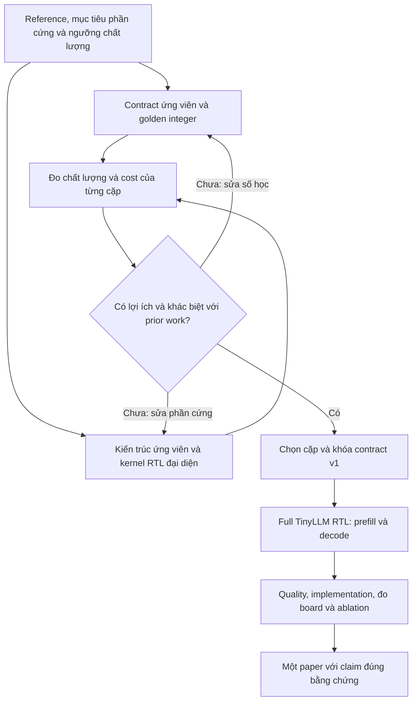

**Chọn một hướng paper khả thi cho TinyLLM**

Ngày cập nhật: 13-10-2026. Mục tiêu: một paper chính. Trạng thái: đề xuất nghiên cứu; chưa phải quyết định kỹ thuật đã chấp nhận hay milestone phát hành.

Đọc kèm [tổng hợp paper về lượng tử hóa và accelerator](quantization_accelerator_review.md), có bảng giải thích các thuật ngữ. Phạm vi nền tảng theo [PROJECT.md](../PROJECT.md) là đầy đủ SmolLM2-135M prefill/decode bằng RTL, hướng tới VCU118; model lớn hơn và tích hợp SoC là các bước tiếp theo.

**1. Khuyến nghị chính**

Mục tiêu chính: **thiết kế accelerator SmolLM2-135M có hiệu năng hoặc chi phí tài nguyên tốt trong ngân sách phần cứng, đồng thời giữ chất lượng model trong ngưỡng đã định**. Chọn một chỉ số chính, chẳng hạn latency decode hoặc tài nguyên dưới giới hạn latency, rồi dùng các chỉ số còn lại làm ràng buộc và phép đánh giá bổ sung.

Giữ chất lượng là điều kiện bắt buộc của thiết kế. Numerical contract và cách hiện thực phần cứng là hai phần cùng cần tối ưu. Đối tượng lựa chọn là một cặp **contract + kiến trúc/cách hiện thực**: cùng contract có thể có nhiều cách tổ chức phần cứng với chi phí khác nhau; một thay đổi số học cũng có thể mở ra hoặc làm mất một cách hiện thực có lợi.

Tập trung một paper cho quá trình kết hợp này, với một cơ chế có lợi ích đo được. Thuật toán lượng tử hóa có thể dùng phương pháp đã có; đóng góp chính có thể nằm ở tổ chức datapath, bộ nhớ, pipeline hoặc điều phối prefill/decode. Không cần đặt điều kiện phải phát minh thuật toán lượng tử hóa mới. Chưa có cơ sở để đưa nhiều paper vào kế hoạch.

Hướng ưu tiên hiện tại: phối hợp chọn số học và tổ chức phần cứng dưới giới hạn bộ nhớ/băng thông/tài nguyên FPGA. Các phép thử ban đầu cần xem cả MAC, truyền weights/KV, buffer, scale/requantization và SFU để xác định phần nào giới hạn mục tiêu. Đường scale/requantization là một giả thuyết có thể kiểm tra, chưa có bằng chứng để chốt nó làm đóng góp chính. Chọn cơ chế theo số đo; không triển khai mọi ứng viên thành các nghĩa vụ riêng.

Đây là hướng có thể bắt đầu kiểm chứng bằng công việc hiện tại, chưa phải đề tài đã chứng minh đủ mới để xuất bản. “Hardware-aware quantization” đã có tiền lệ; phần cần tìm là cơ chế cụ thể và bằng chứng cho lợi ích của nó.

Parameterize và ghi protocol lượng tử hóa là phần nền cần làm dù paper cuối chọn hướng nào. Chưa nên xây compiler tổng quát hoặc thiết kế hỗ trợ mọi họ model ngay từ đầu.

**2. Một bài không nhất thiết phải thắng mọi công trình về mọi chỉ số**

Một đóng góp có thể là cơ chế mới **giải quyết một giới hạn rõ**, **quy luật thực nghiệm có ích cho thiết kế**, công cụ giúp kiểm chứng/khám phá thiết kế, hoặc **một đánh đổi tốt hơn ở miền sử dụng đã xác định**. Nó phải có sự khác biệt so với nghiên cứu trước và bằng chứng đủ để người khác đánh giá.

Ví dụ: giảm bộ nhớ/bytes truyền trong batch=1 mà vẫn đạt ngưỡng chất lượng và latency đã đặt là một mục tiêu khác với đạt token/s cao nhất trên board HBM lớn. Tuy nhiên, việc đổi sang model nhỏ hơn hoặc board khác không tự tạo ra tính mới; cần giải thích cơ chế và kiểm tra lợi ích khi giữ các điều kiện so sánh hợp lý.

[Call for Papers của FPGA 2026](https://isfpga.org/past/fpga2026/call-for-papers/) liệt kê cả computing engines, công cụ/ngôn ngữ thiết kế, design studies, verification và AI/ML. Vì vậy, có nhiều dạng đóng góp ngoài một cuộc đua throughput. Đây là tham khảo phạm vi khoa học, không phải đề xuất deadline đã qua hay lời bảo đảm accept.

Một cách trình bày nên nhắm tới:

“Chúng tôi quan sát vấn đề X trong miền sử dụng Y; đề xuất cơ chế Z; so với các đối chứng A/B, cơ chế giữ được chất lượng trong ngưỡng và cải thiện chi phí C; giải thích khi nào nó có lợi và khi nào không.”

Không nên bắt đầu bằng “chúng tôi viết RTL cho SmolLM2”, “chúng tôi thử nhiều số bit” hoặc “chúng tôi hỗ trợ nhiều model” rồi xem việc hiện thực xong là đủ đóng góp nghiên cứu.

**3. Đánh giá ba ý tưởng ban đầu**

| Ý tưởng                                            | Giá trị thực tế                                                                | Phần còn thiếu để thành đóng góp nghiên cứu                                                                                                                      | Đề xuất                                                                                                            |
| ----------------------------------------------------- | ---------------------------------------------------------------------------------- | --------------------------------------------------------------------------------------------------------------------------------------------------------------------------- | --------------------------------------------------------------------------------------------------------------------- |
| Một datapath chạy nhiều cấu hình bằng firmware. | Giúp tái sử dụng accelerator, mở rộng model và giảm chi phí phát triển. | Tính lập trình đã có ở TATAA/FlightLLM. Cần cơ chế hoặc kết quả mới về overhead, dataflow, phân bổ tài nguyên hay mapping.                               | Giữ các tham số dễ thay đổi trong code; chưa đặt nhiều model bằng firmware làm mục tiêu bài đầu.     |
| Accelerator so với công trình khác về PPA.       | Cần để đánh giá tính hữu ích của thiết kế.                             | Bảng PPA là bằng chứng, chưa phải cơ chế mới. So khác model/context/board/quality không đủ kết luận hơn.                                                    | Dùng làm phần đánh giá của bài kiến trúc; chọn đóng góp kỹ thuật trước.                             |
| Nghiên cứu lượng tử hóa.                        | Cần để giữ chất lượng và định nghĩa số học cho RTL.                   | Một model, một corpus và quét số bit thường chỉ là khảo sát. Cần phương pháp lựa chọn hoặc insight có kiểm chứng và ý nghĩa ngoài một cấu hình. | Dùng làm nền cho bài accelerator; hiện chưa đủ cơ sở chọn một paper thuật toán lượng tử hóa riêng. |

Nguồn tiền lệ cho tính lập trình và mapping: [TATAA](https://arxiv.org/abs/2411.03697), [FlightLLM](https://arxiv.org/abs/2401.03868). Đối với quy trình khám phá precision/cost, đã có [FINN-R](https://arxiv.org/abs/1809.04570) và [HAQ](https://arxiv.org/abs/1811.08886). Do đó, tên gọi chung của các ý tưởng này chưa là tuyên bố tính mới.

**4. Hướng chính, phương án thay thế và hướng chưa khả thi lúc này**

“Khả thi để bắt đầu” nghĩa là có thể thiết kế phép thử nhỏ với nền tảng đang có. Nó chưa có nghĩa đã chứng minh được tính mới, nguồn lực làm toàn bộ hoặc khả năng accept. “Chưa khả thi lúc này” nghĩa là còn thiếu nền tảng, phạm vi hoặc bằng chứng để chọn làm mục tiêu bài đầu; không có nghĩa hướng đó bất khả thi mãi mãi.

A là hướng tổng thể phối hợp số học với kiến trúc. Scale/requantization, đường MAC, KV/dataflow và SFU là các vị trí ứng viên cho cơ chế trong hướng đó; B/C giải thích sâu hai ứng viên. E phục vụ kiểm chứng. Các mục này không phải những bài phải làm riêng.

| Hướng                                                                | Câu hỏi trung tâm                                                                          | Đánh giá hiện tại                                                                                                                   |
| ---------------------------------------------------------------------- | --------------------------------------------------------------------------------------------- | ---------------------------------------------------------------------------------------------------------------------------------------- |
| A. Phối hợp số học và kiến trúc accelerator. | Cặp contract và cách hiện thực nào đạt mục tiêu tốt trong giới hạn chất lượng/tài nguyên? | Khả thi để bắt đầu kiểm chứng; hướng chính tạm thời. Chưa xác nhận novelty. |
| B. KV cache và decode theo giới hạn băng thông. | Làm sao giảm truyền/giải mã KV và metadata mà vẫn giữ chất lượng decode? | Ứng viên cơ chế trong A; chỉ chọn khi profile chứng minh bottleneck và phép thử có lợi ích. |
| C. SFU fixed-point cho RMSNorm/softmax/SiLU.                           | Biểu diễn hoặc schedule nào giảm chi phí phi tuyến trong ngưỡng sai số toàn model? | Chưa đủ bằng chứng chọn làm đóng góp chính; ứng viên thay thế nếu cost khối đáng kể.                                  |
| D. Một bitstream, nhiều cấu hình decoder.                          | Có thể duy trì hiệu suất khi chuyển cấu hình bằng descriptor/microcode?              | Chưa khả thi làm mục tiêu bài đầu với nền tảng hiện tại; thiếu model đầu tiên, mapping và verification đa cấu hình. |
| E. Đánh giá khoảng cách fake-quant → integer → RTL.             | Những lựa chọn nào bị xếp hạng sai khi bỏ qua số bit hữu hạn, scale và cache?     | Khả thi làm phần kiểm chứng của bài chính; chưa đủ bằng chứng cho một paper độc lập.                                    |
| F. Công cụ kiểm chứng từ numerical contract.                      | Mô tả số học/trạng thái có thể giảm lỗi và công sức kiểm chứng thế nào?      | Chưa khả thi chọn làm paper công cụ độc lập; chưa có phương pháp mới và đánh giá hiệu quả.                          |
| G. Tích hợp AI và PQC trong SoC.                                    | Có đánh đổi hệ thống đáng nghiên cứu khi AI/PQC cùng chạy không?                | Chưa khả thi trong phạm vi TinyLLM độc lập; phụ thuộc các owner và hợp đồng hệ thống.                                     |

**Hướng A: phối hợp chọn số học và tối ưu phần cứng**

Câu hỏi khả thi là “với ngưỡng chất lượng cố định và một ngân sách FPGA, cặp contract và cách hiện thực nào đạt mục tiêu tốt nhất trong phạm vi khảo sát?” thay vì chỉ xếp hạng các policy theo số bit/PPL.

Ví dụ giả định: contract thứ nhất dùng ít bit nhưng cần nhiều scale, lượt xử lý và buffer; contract thứ hai dùng nhiều bit hơn ở một số điểm nhưng có đường tính đơn giản hơn. Chưa thể chọn contract thứ nhất chỉ từ số bit thấp hơn. Cũng có thể giữ nguyên một contract đạt chất lượng rồi tăng tốc bằng cách tổ chức bộ nhớ hoặc pipeline tốt hơn. Đây là các khả năng phải đo, không phải kết quả của project.

Tối ưu phần cứng giữ nguyên quy tắc số học có thể dùng golden model hiện có để kiểm tra. Nếu thay độ rộng accumulator, vị trí làm tròn, cách chia scale hoặc thứ tự tính có ảnh hưởng đến kết quả, đó là thay đổi contract và phải đánh giá lại chất lượng. Việc giảm sai số và việc giảm cost phần cứng vì thế có liên hệ, nhưng không phải mọi tối ưu RTL đều buộc đổi số học.

Scale là hệ số để diễn giải giá trị số nguyên; requantization là chuyển kết quả tính về cách biểu diễn của khối tiếp theo. Nếu scale phụ thuộc giá trị lớn nhất của cả token, cần biết giá trị lớn nhất trước khi mã hóa token đó. Việc này có thể phát sinh buffer, thêm lượt xử lý hoặc chờ giữa các khối. Đây là chi phí cần đo, chưa xác nhận là bottleneck của thiết kế.

Phép thử đầu tiên: so đường xử lý tìm scale → lượng tử hóa → ghi/đọc buffer → tính toán với đường tổ chức lại các bước đó để giảm truy cập/chờ. Giữ cùng quy tắc số học khi muốn đo riêng lợi ích tổ chức phần cứng. Nếu thay cách chia nhóm hoặc biểu diễn scale, phải đo lại chất lượng và tách tác động của thay đổi số học khỏi tác động của dataflow.

Phản biện quan trọng: [TATAA §4.6](https://arxiv.org/html/2411.03697v1) đã có quantization và layout conversion trên chip; [FlightLLM §3.2](https://arxiv.org/html/2401.03868v2) đã tổ chức xử lý hai lượt và che latency của SFU. Vì vậy, “thêm khối lượng tử hóa” hoặc “ghép các bước để giảm truy cập” chưa đủ mới. Phải đối chiếu cơ chế cụ thể, chẳng hạn xử lý scale động trong đường residual/decoder với precision hỗn hợp. Chưa có kết quả để khẳng định cơ chế như vậy khác tiền lệ và có lợi.

Tập precision chỉ nên gồm các mode hardware có lợi; tính đủ cost tìm scale, requantization và metadata; tăng precision tại điểm/layer nhạy nếu cần. Nếu chỉ dùng mixed precision đã biết mà không thêm cơ chế hoặc insight, nó vẫn là nền kỹ thuật, chưa đủ để tuyên bố một đóng góp nghiên cứu mới.

Đối chứng tối thiểu: một policy đơn giản; policy hiện tại giữ chất lượng tốt; lựa chọn chỉ dựa vào chất lượng/số bit; lựa chọn có phản hồi phần cứng. Giữ cùng model, dữ liệu, context và ngưỡng chất lượng.

Bằng chứng cần có: chất lượng trên tập độc lập, cost scale/accumulator được tính đủ, ít nhất kernel RTL với synthesis và timing, một đường end-to-end để xác nhận dự đoán. Nếu phép lựa chọn chỉ đổi dung lượng trên giấy mà datapath/băng thông không hưởng lợi, dừng tuyên bố tăng tốc.

Đây là hướng tận dụng trực tiếp việc đang làm trong `quant/`. [HAQ](https://arxiv.org/abs/1811.08886) và [HAWQ-V3](https://proceedings.mlr.press/v139/yao21a.html) là tiền lệ cần so để tránh gọi nguyên tắc chọn precision theo hardware là mới.

**Hướng B: xử lý KV và scale cho decode trên bộ nhớ giới hạn**

Ứng viên câu hỏi: số bit thấp có thực sự giảm thời gian decode sau khi tính đủ scale, zero-point, layout và lượng dữ liệu DDR? Có thể tổ chức read/compute/write để phần tiết kiệm dữ liệu chuyển thành giảm stall không?

Ứng viên cơ chế: tile/cache metadata phù hợp luồng GQA; ghép đọc scale với phép tính attention; bố trí K và V theo các pattern truy cập khác nhau; chỉ dùng một số mode precision có mapping hiệu quả. Đó là các ý tưởng cần thiết kế và kiểm tra, chưa phải cơ chế mới đã xác nhận.

Đối chứng: cache FP16 hoặc precision cao phù hợp; KV8 đơn giản; KV thấp bit với layout đơn giản; cùng số bit với layout/schedule đề xuất. Ghi bytes truyền thực, scale overhead, stall cycles và latency/context; giữ chất lượng trong ngưỡng.

Chỉ ưu tiên hướng này nếu profile cho thấy KV/DDR chiếm phần đáng kể. Nếu weight streaming hoặc GEMV chiếm phần lớn, tối ưu KV có thể ít tác động end-to-end; khi đó KV là phần phụ, không nên ép thành paper chính.

[KIVI](https://proceedings.mlr.press/v235/liu24bz.html) và [KVTuner](https://proceedings.mlr.press/v267/li25dd.html) là đối chứng về policy; [FlightLLM](https://arxiv.org/abs/2401.03868) là đối chứng về tổ chức decode. Không đặt mục tiêu mặc định phải dùng KV2 mới đủ mới.

**Hướng C: một khối SFU có hợp đồng sai số cho model**

SFU là khối xử lý những hàm như RMSNorm, softmax và SiLU ngoài phép nhân ma trận chính. Có thể thử cùng một tập primitive, bộ nhân/cộng, cơ chế normalization và bảng tra để phục vụ một số hàm, thay vì tạo nhiều khối độc lập.

Phạm vi ban đầu nên là một hoặc hai hàm có cost đáng kể, chẳng hạn rsqrt của RMSNorm và exp/reciprocal của softmax. So LUT riêng, xấp xỉ số nguyên đã biết và khối đề xuất. “Dùng LUT” hoặc “dùng chung khối” tự nó chưa mới; cần một cơ chế giảm chi phí, quản lý độ chính xác hoặc schedule đủ khác với tiền lệ.

Đo ba lớp bằng chứng: sai số hàm trên miền có ý nghĩa và trường hợp biên; chất lượng toàn model khi thay khối; area/timing/latency của RTL và ảnh hưởng end-to-end. Sai số trung bình nhỏ trên một miền dễ không đủ nếu clip hoặc underflow làm hỏng model.

Nếu khối mới tiết kiệm tài nguyên nhưng ít ảnh hưởng latency, vẫn có thể hữu ích nếu mục tiêu chính là giảm tài nguyên. Cần đánh giá đúng mục tiêu đã đặt. Chỉ chọn SFU làm đóng góp chính khi lợi ích và sự khác biệt với tiền lệ đủ rõ; nếu không, giữ nó làm một khối bình thường trong accelerator.

Đọc [I-BERT](https://proceedings.mlr.press/v139/kim21d.html), [I-LLM](https://arxiv.org/html/2405.17849v2), [FQ-ViT](https://www.ijcai.org/proceedings/2022/164), [TATAA](https://arxiv.org/abs/2411.03697). Những bài này là tiền lệ; không có cơ sở khẳng định SFU chung đã là khoảng trống nghiên cứu.

**Hướng D: nhiều cấu hình model bằng một bitstream**

Phân biệt parameterize lúc synthesis với thay cấu hình khi đang chạy. Nếu đổi hidden size rồi phải synthesis bitstream mới, đó chưa là “một datapath thay model bằng firmware”.

Phạm vi hợp lý là cùng một tập toán tử decoder, với giới hạn shape và bộ nhớ công bố. Firmware/descriptor cung cấp số layer, kích thước, head mapping, địa chỉ weights/scales/KV, schedule và mode precision. Không hứa chạy một model có toán tử chưa được hardware hỗ trợ chỉ bằng firmware.

Đóng góp cần tìm: mapping/schedule phù hợp nhiều shape mà không lãng phí phần lớn lane; chi phí điều khiển nhỏ; cách thay mode prefill/decode/precision; hoặc giảm chi phí tạo mapping so với tiền lệ. Bắt đầu với hai checkpoint thật cùng họ và thêm cấu hình chưa dùng để điều chỉnh thiết kế nếu nguồn lực cho phép.

So cùng engine ở mode generic và specialized, với cùng contract; nếu có thể tạo bản specialized cùng ngân sách tài nguyên thì đó là đối chứng tốt hơn. Báo overhead throughput/tài nguyên và thời gian nạp/switch model riêng, không trộn reload weights vào một phép đo rồi bỏ qua ở baseline.

Hướng này tái sử dụng được hạ tầng nhưng tăng nhiều ca verification và công việc điều khiển. Hiện chưa nên đưa vào phạm vi bài đầu. Tính programmable và compiler/mapping đã có ở [TATAA](https://arxiv.org/abs/2411.03697) và [FlightLLM](https://arxiv.org/abs/2401.03868); các vòng lặp nhận tham số chưa đủ làm đóng góp mới.

**Hướng E: nghiên cứu các lựa chọn số học bị fake-quant che khuất**

Câu hỏi cụ thể: thứ hạng policy theo PPL fake-quant có còn giữ khi scale được biểu diễn hữu hạn, phép cộng residual phải align scale, accumulator có giới hạn và KV được cập nhật streaming?

Có thể tạo một nghiên cứu gồm nhiều configuration/checkpoint và context, phân rã nguyên nhân sai số, rồi đưa ra một quy trình hoặc phương pháp sửa. Đây có thể là insight hữu ích dù không tạo thuật toán quantization SOTA. Nhưng một lỗi riêng trong code hoặc một bảng sweep trên một model chưa đủ độ khái quát cho bài đầy đủ.

Đối chứng gồm fake-quant với cùng quy tắc đã định, golden model integer và các kernel RTL. Khi phát hiện khác biệt, tách lỗi implementation khỏi giới hạn của policy; không lấy code sai làm bằng chứng phương pháp quantization sai.

Outlier token 0 đã quan sát là một điểm khảo sát, nhưng không tự coi nó là phát hiện mới. Đã có [Massive Activations](https://arxiv.org/abs/2402.17762) và [PrefixQuant](https://arxiv.org/abs/2410.05265). Giá trị mới có thể nằm ở cách hiện thực/đánh giá chúng trong SLM và giới hạn FPGA cụ thể, nếu được kiểm chứng và đối chiếu thêm.

Hiện giữ phần này làm nền kiểm chứng và ablation của bài chính. Chưa có dữ liệu để chọn nó thành paper độc lập.

**Hướng F: kiểm chứng theo contract cho decoder có trạng thái**

Một công cụ có thể dùng cùng mô tả dtype/scale/rounding/shape và quy tắc KV để sinh golden model, vector biên và kiểm tra RTL. Điểm cần nghiên cứu là cách phát hiện/minimize sai khác hoặc giảm effort so với testbench viết tay; không chỉ việc có một file JSON và chạy so kết quả.

Ứng viên cơ chế: kiểm tra bất biến trạng thái cache/position khi có stall; tạo vector số học nhắm vào tie/overflow/scale mismatch; tự đưa một sai khác toàn model về khối và phép toán đầu tiên gây lỗi. Bắt đầu ở vài khối và một layer trước khi tự xây một framework compiler lớn.

Đánh giá bằng lỗi cố ý chèn có định nghĩa, khả năng phát hiện và định vị, thời gian chạy/công sức xây test được ghi nhận, số ca lỗi còn bỏ sót; thêm một case study decoder thật. Không gọi là formal verification nếu chỉ kiểm tra một tập vector hữu hạn.

[QONNX](https://arxiv.org/abs/2206.07527) đã mô tả quantization arbitrary precision, còn [FINN-R](https://arxiv.org/abs/1809.04570) có quy trình khám phá/sinh accelerator. Cần xác định phần mới ở finite-width và trạng thái streaming của decoder; không khẳng định xây một mô tả precision chung là phát minh mới.

Hiện dùng test vector và so golden để bảo đảm tính đúng. Chưa có cơ sở mở phạm vi thành một framework hay paper công cụ. Chỉ xem xét lại nếu xuất hiện một phương pháp mới và phép đo cho thấy nó giải quyết tốt vấn đề kiểm chứng.

**Hướng G: nghiên cứu hệ thống SoC có AI và PQC**

Sau khi TinyLLM độc lập chạy được, có thể nghiên cứu việc chia tài nguyên và phục vụ workload đồng thời, hoặc cơ chế kiểm tra nguồn gốc/toàn vẹn model trong luồng nạp với chữ ký. Đóng góp phải là cơ chế hoặc phân tích hệ thống: chính sách arbitration, isolation, lịch DMA, chi phí kiểm chữ ký/lưu trữ hay mức ảnh hưởng lên latency/chất lượng dịch vụ.

“Nối RISC-V, TinyLLM và Dilithium” chưa tự là một đóng góp mới. Một chữ ký kiểm model cũng không tự chứng minh toàn bộ suy luận an toàn; yêu cầu bảo vệ và mô hình đe dọa phải được xác định nếu chọn hướng security.

Đối chứng: các subsystem chạy độc lập, chạy đồng thời với chính sách đơn giản, rồi chính sách đề xuất; giữ workload và ngân sách có thể so. Mục tiêu là tìm và giải thích tương tác liên subsystem, không gộp ba khối vào sơ đồ rồi chỉ đo throughput chung.

Đây là hướng cần hợp tác với các owner và project architect. Ghi chú này không giao quyền sửa `src/riscv/`, `src/dilithium/` hoặc tự chốt interconnect/memory map. Hiện thiếu điều kiện để chọn hướng này làm paper TinyLLM; không đưa nó vào điều kiện hoàn thành bài đầu.

**5. Cách chọn hướng trước khi viết RTL lớn**

Thực hiện ba thử nghiệm nhỏ để giảm mơ hồ:

1. Xác minh reference và một policy giữ chất lượng tốt, rồi kiểm tra gap khi chuyển một số phép tính sang integer hữu hạn.
2. Lập bảng bytes/cycles sơ bộ cho linear, nonlinear, weight/KV và scale; synthesis vài kernel với các mode precision đại diện.
3. So hai cách hiện thực hoặc policy có một thay đổi cụ thể. Xem thay đổi nào cải thiện mục tiêu khi đã tính thêm overhead.

Sau đó chọn một cơ chế làm đóng góp chính. Các lựa chọn số học và cách tổ chức phần cứng được điều chỉnh qua lại: có thể giữ contract và đổi dataflow, hoặc đổi contract nếu chi phí hiện thực quá cao. Chọn scale/requantization, KV/dataflow, SFU hay đường MAC theo phần giới hạn mục tiêu đã đo được. E là phần kiểm chứng để tránh chọn sai policy. Chọn một cơ chế được dữ liệu hỗ trợ; không cộng mọi ứng viên vào phạm vi.

Không cần tin trước mình sẽ vượt một con số của paper lớn. Cần có một thử nghiệm nhỏ đủ để bác bỏ hoặc hỗ trợ giả thuyết. Nếu dữ liệu không ủng hộ, đổi hướng trước khi đầu tư vào phần còn lại.

Độ mới vẫn cần kiểm tra sâu sau khi cơ chế đã cụ thể. Danh sách paper đang có không phải bằng chứng rằng không tồn tại prior work khác.

**6. Lộ trình từ numerical contract đến một paper**

M1 và M2 dưới đây là một vòng lặp: có baseline số học ban đầu là có thể khảo sát kernel/kiến trúc, rồi dùng cost đó để sửa contract hoặc cách hiện thực. Không cần hoàn tất việc tìm contract tốt nhất trước khi bắt đầu tối ưu phần cứng.

| Chặng                     | Việc cần làm                                                                                  | Điều kiện chuyển tiếp                                                                                                                               |
| -------------------------- | ------------------------------------------------------------------------------------------------ | -------------------------------------------------------------------------------------------------------------------------------------------------------- |
| M0: câu hỏi và baseline | Reference, workload, ngưỡng chất lượng, data splits, đối chiếu nghiên cứu trước.     | Reference được kiểm tra; cách đo và mục tiêu rõ.                                                                                               |
| M1: số học thực         | Một baseline an toàn và 2–3 contract ứng viên; golden integer, decode, case biên.         | Chất lượng trên tập chọn policy đạt ngưỡng; số học được mô tả đủ để viết RTL.                                                      |
| M2: chọn đóng góp      | Kernel RTL đại diện, cost/timing, so baseline với cơ chế ứng viên.                       | Có lợi ích sau khi tính overhead và có khác biệt cụ thể với prior work. Nếu chưa có, điều chỉnh giả thuyết trước khi làm RTL lớn. |
| M3: khóa và hiện thực  | Chọn contract/cơ chế, khóa version, scheduler qua các layer, weights thật, prefill/decode. | RTL khớp golden; full model chạy được trong phạm vi hỗ trợ.                                                                                      |
| M4: đánh giá và viết  | Quality trên tập cuối độc lập, implementation/board, ablation, giới hạn và artifact.    | Mỗi claim có phép đo phù hợp; đủ dữ liệu để viết một paper.                                                                                |

Khóa sớm model, workload, cách đo và phạm vi. Contract chi tiết nên khóa sau khi golden và kernel cost được kiểm tra, trước khi triển khai RTL đầy đủ. Không cần tìm “tối ưu tuyệt đối” rồi mới viết bất kỳ RTL nào: kernel nhỏ chính là công cụ giúp chọn contract. Nếu số đo sau này buộc thay contract, tăng version và kiểm tra lại các phần bị ảnh hưởng.

Sau khi khóa contract, vẫn tiếp tục tối ưu phần cứng: bố trí bộ nhớ, số lane, pipeline, overlap và scheduler trong các quy tắc số học đã thống nhất. “Khóa contract” giúp kiểm chứng kết quả, không có nghĩa kiến trúc đã tối ưu xong. Kiểm tra timing, tài nguyên và hiệu năng toàn model để biết lợi ích kernel có còn giữ ở mức hệ thống hay không.

Chỉ xem xét một bài tiếp theo sau khi bài chính có đủ kết quả và thực sự phát hiện câu hỏi, cơ chế, dữ liệu mới đủ độc lập. Hiện chưa có bằng chứng cho điều đó, nên không đặt bài tiếp theo vào kế hoạch. Nếu sau này xem xét, kiểm tra chính sách đúng venue về tính mới và công trình đã công bố; đổi tiêu đề hoặc thêm một model không tự đủ.

**7. Nên lưu gì từ đầu để viết bài và tái lập kết quả**

| Artifact                                                          | Công dụng                                                                         |
| ----------------------------------------------------------------- | ----------------------------------------------------------------------------------- |
| Model/data/library manifest và token IDs.                        | Tái lập quality baseline và mọi policy.                                         |
| Contract có version, golden integer và test vector.             | Phân biệt sai số model với lỗi RTL; tái sử dụng qua các kernel/model.      |
| Policy đầy đủ và lý do chọn/bỏ.                           | Viết ablation, giải thích trade-off và tránh chỉ báo cáo cấu hình thắng. |
| Các bản kernel/baseline được giữ bằng Git đúng workflow. | So cùng điều kiện và tái lập lợi ích của cơ chế mới.                   |
| Synthesis/P&R reports, clock constraints và cycles.              | Biết cost/timing thực; không chỉ lưu một con số tóm tắt.                   |
| Trace/counters cho DDR, scale, KV, compute và stall.             | Chọn đúng bottleneck và giải thích vì sao tăng tốc.                        |
| Đo quality/end-to-end trên workload cố định.                 | Chứng minh accelerator giữ model hữu ích trong phạm vi đã nêu.              |
| Bảng claim → evidence → source.                                | Biết câu nào đã chứng minh, câu nào còn là giả thuyết.                  |

Ví dụ bảng claim/evidence:

| Claim ứng viên                             | Phép đo để có thể nói điều đó                                                                    |
| -------------------------------------------- | ----------------------------------------------------------------------------------------------------------- |
| “Cách mới giảm tải KV.”                | Bytes DDR/cache thực, metadata và context cố định; không chỉ lấy bit thấp nhân số phần tử.     |
| “Cách mới giữ chất lượng.”           | Reference đã xác minh, tập test độc lập, ngưỡng chất lượng và task/context công bố.          |
| “Đổi model không cần đổi bitstream.” | Ít nhất hai checkpoint thật chạy end-to-end với cùng bitstream; ghi descriptor/firmware và overhead. |
| “SFU giảm tài nguyên.”                  | So RTL các cách tính cùng yêu cầu sai số/throughput, rồi kiểm tra chất lượng toàn model.       |
| “Công cụ tìm lỗi tốt hơn.”           | Lỗi chèn/bug case có căn cứ, cùng ngân sách test và đối chứng, tỷ lệ phát hiện/định vị.  |

**8. So sánh PPA và chọn loại bài cho đúng**

Trên FPGA, LUT/FF/DSP/BRAM/URAM là tài nguyên implementation; không phải diện tích ASIC theo mm². Power ước lượng bằng tool khác power đo board; phải ghi đúng loại bằng chứng. Không tuyên bố ASIC PPA khi chưa có flow thư viện/corner tương ứng.

So sánh mạnh nhất là với baseline chạy trên cùng platform, cùng model và chất lượng/workload. Nếu không tái hiện được accelerator người khác, ghi rõ bảng literature dùng số công bố và điều kiện khác; nó giúp đặt bối cảnh, không tự chứng minh thắng trực tiếp.

Đo riêng prefill, decode và end-to-end; công bố batch, prompt/context, số token sinh, dtype/contract, clock, dữ liệu trong/ngoài chip, overhead nạp model và cách tính power. TOPS đỉnh hoặc microbenchmark GEMM không thay cho model token/s.

Loại bài nên chọn theo kết quả: cơ chế đầy đủ và end-to-end có thể nhắm research paper về architecture/design studies; cơ chế khối với đánh giá đủ sâu có thể phù hợp short paper; quan sát/công cụ ban đầu có thể phù hợp workshop hoặc artifact/demo nếu venue có track đó. Không có quy tắc một track “dễ accept”; CFP/review yêu cầu riêng và phải kiểm tra đúng kỳ.

**9. Các hướng tôi chưa ưu tiên cho bài đầu**

Huấn luyện model mới từ đầu, tạo hệ ternary mới, chuyển toàn pipeline sang vector quantization, xây compiler hỗ trợ mọi transformer hoặc nghiên cứu security toàn SoC đồng thời. Chúng có thể có giá trị nhưng làm tăng phạm vi trước khi nền tảng hiện tại được kiểm chứng.

Một board demo chạy được vẫn là thành quả engineering cần đạt. Để thành paper, cần thêm câu hỏi và bằng chứng giải thích cơ chế. Nếu chưa thấy đóng góp độc lập, dùng thời gian để củng cố chất lượng, baseline và tính tái lập; không bịa cơ chế mới hoặc mục tiêu phần trăm cải thiện.

**10. Bản đề xuất ngắn để bắt đầu kiểm chứng**

Tên làm việc: “Accelerator FPGA cho SmolLM2-135M: giữ chất lượng với chi phí số học và truyền dữ liệu có kiểm chứng”. Đây là tên mô tả mục tiêu; tên paper cuối phải nêu cơ chế đã chứng minh, không tuyên bố kết quả chưa có.

| Nội dung                  | Đề xuất ban đầu                                                                                                                                                                                                                            |
| -------------------------- | ----------------------------------------------------------------------------------------------------------------------------------------------------------------------------------------------------------------------------------------------- |
| Miền sử dụng            | SmolLM2-135M base, batch=1, đầy đủ prefill/decode, VCU118/DDR4; công bố các context được hỗ trợ.                                                                                                                                    |
| Câu hỏi chính           | Với cùng ngưỡng chất lượng, tổ chức đường scale/requantization có giảm buffer/truy cập/stall và cost accelerator so với cách đơn giản không?                                                                              |
| Giả thuyết               | Policy giữ chất lượng có thể tốn chi phí ngoài MAC; giảm chi phí đó giúp đạt đánh đổi tốt hơn. Chưa xác nhận giả thuyết.                                                                                             |
| Cơ chế ứng viên        | Tổ chức lại bước tìm scale, chuyển precision và luồng buffer để giảm lượt xử lý/chờ; bắt đầu bằng một đường tính ở một layer.                                                                                       |
| Đối chứng               | Cùng policy/số học với đường xử lý đơn giản; thêm baseline precision cao đủ chất lượng. So policy khác là phép đánh giá riêng.                                                                                         |
| Chỉ số chính            | Chọn trước một mục tiêu như latency decode hoặc tài nguyên dưới giới hạn latency. Đo cycles, buffer, bytes, DSP/LUT/BRAM và clock để giải thích.                                                                            |
| Điều kiện chất lượng | Chọn giới hạn tăng PPL và giảm điểm task trước khi chọn ứng viên cuối; test cuối độc lập. Chưa có số đo để chốt các ngưỡng trong note này.                                                                         |
| Phép thử nhỏ            | Golden integer cho đường tính và hai kernel RTL cùng yêu cầu throughput/số học; kiểm tra sai số, cost và timing. Không cần toàn bộ SoC để thử giả thuyết.                                                                 |
| Điều kiện dừng/đổi   | Overhead đã nhỏ; giảm cost cục bộ không giúp mục tiêu đã chọn; chất lượng không đạt; hoặc prior work đã giải quyết cùng cơ chế mà không có khác biệt đáng kể. Khi đó kiểm tra B/C, chưa mở thêm paper. |
| Kết quả để viết bài  | Một cơ chế có khác biệt rõ, kiểm chứng số học, full-model quality, cost/hiệu năng thực và ablation; chưa khẳng định hiện đã có.                                                                                          |

Việc tiếp theo cụ thể là hoàn thiện reference và protocol đánh giá; trong cùng giai đoạn tạo contract/golden ứng viên và khảo sát kernel/dataflow đại diện. So các cặp đạt chất lượng bằng cost phần cứng, tìm phần giới hạn mục tiêu, rồi chọn một cơ chế để làm sâu. Bản đề xuất về scale/requantization ở trên là một phép thử cụ thể cho quá trình đó, chưa là phạm vi đóng góp đã chốt. Đối chiếu prior work của cơ chế được chọn trước khi đầu tư RTL lớn.

Ghi chú chưa xác định lịch hay venue cụ thể vì chưa có quỹ thời gian, ngân sách công cụ/board và yêu cầu tốt nghiệp/công bố. Những điều đó ảnh hưởng kế hoạch, nhưng không ngăn thực hiện các phép thử nền tảng trên.
